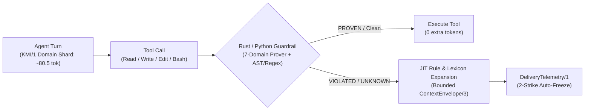

# Kintsugi Harness (`v3.1.1`)

[](https://github.com/tunguyen1993/kintsugi-harness/actions/workflows/ci-and-arena-verification.yml)
[](https://securityscorecards.dev/viewer/?uri=github.com/tunguyen1993/kintsugi-harness)
[](LICENSE)
[](Cargo.toml)
[](pyproject.toml)
[](Cargo.toml)

**Zero-dependency Rust (`MSRV 1.75.0`) + Python (`3.9+` stdlib) pre-tool security guardrails, 7-domain typed obligation prover, MCP server, and standalone Cloud Sandbox CLI for AI coding agents.**

Designed for **OpenAI Codex CLI**, **Claude Code**, **Cursor**, **Windsurf**, **Cline**, and **Zed**.

---

## 1. What Kintsugi Harness Is

Static rule files (`AGENTS.md`, `CLAUDE.md`, `.cursorrules`) are advisory prose: they consume thousands of tokens per turn and do not prevent an agent from issuing unsafe shell commands, SQL concatenations, path traversals, or broken cryptographic checks under pressure.

Kintsugi Harness replaces advisory-only prompts with deterministic, zero-dependency enforcement:

- **Native Rust Engine (`kintsugi-rs`, `std`-only, `MSRV 1.75.0`):** Sub-millisecond pre-tool security scanning (`~16.2 µs/call` across 36 built-in rules on Apple Silicon), staged git-diff hunk filtering, and fail-closed `PreToolUse` hook evaluation.
- **7-Domain Typed Obligation Prover:** Emits explicit 4-way static verdicts (`PROVEN` | `VIOLATED` | `UNKNOWN` | `UNSUPPORTED`) with `0` false `PROVEN` verdicts on the repository's negative test corpus.
- **Built-In MCP Server (`kintsugi mcp`):** Zero-dependency JSON-RPC 2.0 `stdio` server exposing static scanning, context-aware file reading, pitfall lexicon lookup, delivery telemetry, and context compaction over standard MCP.
- **Standalone Cloud Sandbox Edition (`cloud-sandbox/` · `v3.1.1`):** Pure Python `3.9+` stdlib CLI for ephemeral or restricted cloud coding sandboxes with pinned SHA-256 GitHub self-update, 2-process OS subprocess IPC Truth Gate, fail-closed AST+regex scanning, exact rational `Fraction` financial checks, and read-only transaction policy guards.
- **Domain-Partitioned `KMI/1` Context Compression:** Compiles verbose security rules into compact `<12`-token symbolic headers expanded Just-In-Time only when a rule fires.

---

## 2. Quick Start & OpenAI Codex CLI / MCP Integration

### Install

```bash
git clone https://github.com/tunguyen1993/kintsugi-harness.git
cd kintsugi-harness
pip install -e .

# Optional: build the zero-dependency native Rust CLI (`kintsugi-rs`)
cargo build --release
```

### Core CLI Commands

```bash
# Scan a repository or staged git diff (Python AST + regex scanner)
kintsugi scan . --staged --fail-on HIGH

# Run the native Rust 7-domain typed obligation prover
./target/release/kintsugi-rs s3-audit src/ --strict-proven --format json

# Generate a bounded JIT context envelope + low-tier pitfall brief for a file
./target/release/kintsugi-rs context src/app.py --low-tier --format json
./target/release/kintsugi-rs lexicon src/App.tsx --format compact

# Compile compact KMI/1 governance files (AGENTS.md, CLAUDE.md, Cursor, Copilot, Windsurf)
kintsugi compile --targets all --compact
```

### OpenAI Codex CLI Integration (`~/.codex/config.toml`)

Register Kintsugi as a local `stdio` MCP server in `~/.codex/config.toml`:

```toml
[mcp_servers.kintsugi]
command = "kintsugi"
args = ["mcp", "--profile", "v3", "--ledger", ".kintsugi/scars.json"]
```

Verify the MCP server starts cleanly over stdio:

```bash
kintsugi mcp --profile v3
```

### Claude Code, Cursor, Windsurf, Cline & Zed MCP Configuration

Add the following to `.mcp.json`, `.cursor/mcp.json`, or `claude_desktop_config.json`:

```json
{
  "mcpServers": {
    "kintsugi-harness": {
      "command": "kintsugi",
      "args": ["mcp", "--profile", "v3", "--ledger", ".kintsugi/scars.json"]
    }
  }
}
```

### Claude Code `PreToolUse` Hook

Install hooks automatically (`kintsugi install-hooks --git`) or wire `kintsugi-rs` directly in `.claude/settings.json`:

```json
{
  "hooks": {
    "PreToolUse": [
      {
        "matcher": "Write|Edit|MultiEdit|Bash",
        "hooks": [
          {
            "type": "command",
            "command": "kintsugi-rs hook claude-pre-tool --block-on HIGH"
          }
        ]
      }
    ]
  }
}
```

### Key MCP Tools (`kintsugi mcp --profile v3`)

The MCP server exposes `9` core tools under the default profile and `26` tools under `--profile v3`, alongside `2` resources (`kintsugi://ledger/scars`, `kintsugi://posture/summary`) and `2` prompts (`kintsugi-audit-code`, `kintsugi-evolve-scar`):

| Tool | Purpose |
| :--- | :--- |
| `kintsugi_scan_code` | Deterministic AST + regex scan of inline code or file paths before writing/committing. |
| `kintsugi_read_with_context` | POSIX `dir_fd` (`O_NOFOLLOW`) bounded file read with CRLF-verbatim digest parity and JIT context injection. |
| `kintsugi_low_tier_lexicon` | Symbol-scoped lookup into the 80-entry pitfall lexicon (`LT-001..LT-080`). |
| `kintsugi_delivery_telemetry` | Record and query `DeliveryTelemetry/1` receipt stages and 2-strike auto-freeze state. |
| `kintsugi_list_scars` | List verified guardrails or emit a single domain-partitioned `KMI/1` shard. |
| `kintsugi_record_failure` | Compile a runtime/test failure into a self-verified guardrail (`scan(bad) >= 1`, `scan(good) == 0`). |
| `kintsugi_verify_logic` | Run deterministic SAT/Datalog/difference-logic and auth state-machine verification. |
| `kintsugi_integrate_harness` | Discover, quarantine, conflict-check, mount, or eject third-party agent rule files cleanly. |
| `kintsugi_compact_context` | Strip verbose logs and superseded file reads while preserving user intents and hard anchors. |

### GitHub Actions Integration

Kintsugi ships a composite action ([`action.yml`](action.yml)) and can run directly in CI workflows:

```yaml
- name: Run Kintsugi security scan
  run: |
    pip install -e .
    kintsugi scan . --fail-on HIGH
```

---

## 3. Zero-Dependency Cloud Sandbox Edition (`cloud-sandbox/` · `v3.1.1`)

For ephemeral or restricted cloud coding sandboxes with only Python `3.9+` stdlib (no Rust toolchain, no `pip` network access), `cloud-sandbox/` provides a self-contained, hardened edition:

- **Pinned SHA-256 GitHub Self-Updater (`bootstrap.py`):** Verifies explicit bootstrap and manifest digests (`--require-pin`, `--require-full-sha`, `--expected-bootstrap-sha256`, `--expected-manifest-sha256`), performs `dir_fd` (`O_NOFOLLOW`) safe extraction against symlink/path traversal, supports offline `.tar.gz`/`.zip` fallback (`--source-archive`), and runs a clean-environment boot smoke check before atomic directory swap.
- **2-Process OS Subprocess IPC Truth Gate:** Executes candidate tests in isolated Python and Node.js subprocesses communicating over OS IPC with runtime-counted assertions, verifying real `BROKEN -> FIXED` transitions rather than trusting self-reported model output.
- **Fail-Closed AST + Regex Security Scanner:** Multi-language scanner returning `INCOMPLETE_SCAN` fail-closed verdicts on parse errors, unreadable targets, symlink escapes, or oversized inputs.
- **Exact Rational `Fraction` Financial Verification:** Arbitrary-precision `fractions.Fraction` conservation, FX conversion, and tick-rounding checks eliminating IEEE-754 floating-point drift.
- **Read-Only Transaction Policy Guard (`tx-guard`):** Pre-flight policy gate rejecting unauthorized outbound value transfers, token approvals, or advance-deposit requirements.
- **5-Gate Closed-Loop Scar Evolution:** Candidate synthesis -> 2-process IPC Truth Gate -> matcher-on-broken validation -> canary regression replay -> SHA-256 attested patch export/import.

```bash
# Pinned SHA-256 install in a restricted cloud sandbox (replace placeholders with release digests):
curl -fsSL "https://raw.githubusercontent.com/tunguyen1993/kintsugi-harness/<40-hex-commit-sha>/cloud-sandbox/bootstrap.py" -o /tmp/k_boot.py \
  && python3 /tmp/k_boot.py \
       --ref "<40-hex-commit-sha>" \
       --require-pin \
       --require-full-sha \
       --expected-bootstrap-sha256 "<64-hex-bootstrap-sha256>" \
       --expected-manifest-sha256 "<64-hex-manifest-sha256>" \
       --dest /tmp/kintsugi_sandbox
```

See [`cloud-sandbox/README.md`](cloud-sandbox/README.md), [`cloud-sandbox/TASKS.md`](cloud-sandbox/TASKS.md), and [`cloud-sandbox/AGENT_INSTRUCTIONS.md`](cloud-sandbox/AGENT_INSTRUCTIONS.md) for the full sandbox CLI reference (`boot`, `self-test`, `brief`, `scan`, `tx-guard`, `truth-gate`, `ledger-check`, `verify-delivery`, `audit-deliverable`, and `evolve`).

---

## 4. Architecture & Security Guarantees



### 7-Domain Typed Obligation Prover (`rust/src/audit/{obligation_prover,prover_extensions}.rs`)

Every obligation is evaluated to one of four explicit verdicts—`PROVEN`, `VIOLATED`, `UNKNOWN`, or `UNSUPPORTED`—backed by a UTF-8 byte-aligned `StatefulMasker` and fail-closed `NO_INPUT` handling for missing, unreadable, symlink, or empty targets (`0` false `PROVEN` verdicts on the repository's negative test corpus):

| Domain | Languages | Obligation Verified |
| :--- | :--- | :--- |
| `CMD_EXEC` | Python, TS/JS | Rejects shell execution (`shell=True`, dynamic `shell=` expressions, shell trampolines like `sh -c`, opaque options objects). |
| `SQL_EXEC` | Python, TS/JS | Requires parameterized queries; rejects string formatting/concatenation into SQL execution sinks. |
| `PATH_CONFINE` | Python, TS/JS, Rust | Requires canonical path containment against traversal outside an allowed root before filesystem reads/writes. |
| `CRYPTO_MAC_BIDI` | Python, TS/JS | Enforces constant-time MAC comparisons and rejects Trojan Source bidirectional Unicode overrides. |
| `TSX_XSS` | React `.tsx`/`.jsx` | Flags unsafe HTML injection (`dangerouslySetInnerHTML`, unsanitized `javascript:` URLs). |
| `SOL_REENTRANCY_CEI` | Solidity `.sol` | Checks Checks-Effects-Interactions ordering and reentrancy guards around external calls. |
| `SOL_SAFE_ERC20` | Solidity `.sol` | Requires exact `SafeERC20.sol` import, scoped `using SafeERC20 for <ERC20Type>`, and verified receiver typing. |

### 80-Entry Low-Tier Model Pitfall Lexicon (`LT-001..LT-080`)

Located in [`rust/src/audit/low_tier_lexicon.rs`](rust/src/audit/low_tier_lexicon.rs), the lexicon maps symbol-scoped, recurring coding-agent failure modes across Python, OWASP Security, TypeScript/React/Next/Vue, MySQL, Solidity `0.8.24`/DeFi, Go, Rust, Docker, and GitHub Actions. Entries are injected Just-In-Time only when matching symbols/imports appear (`0` matches / `0` tokens on the repository's benign fixture corpus).

### 9 Signature-Guarded Invariant Capsules (`rust/src/audit/capsules.rs`)

High-impact security and financial invariants (including ERC-4626 share bounds, replay-safe signature verification, and atomic locking) are packaged as signature-guarded capsules so injected reminders respect target function signatures (for example, never instructing a `-> bool` verifier to raise exceptions).

### Delivery Telemetry (`DeliveryTelemetry/1`)

Implemented with cross-runtime Rust and Python parity ([`rust/src/audit/delivery_telemetry.rs`](rust/src/audit/delivery_telemetry.rs), [`src/kintsugi/evolution/delivery_telemetry.py`](src/kintsugi/evolution/delivery_telemetry.py)):

- Tracks 3 distinct receipt stages: `issued -> included_in_input -> patch_bound`.
- Protects efficacy accounting so unshown capsules (`included_before_first_patch == false`) never pollute metrics.
- Enforces cross-process file locking (`0600`) and **2-Strike Auto-Freeze**: if a capsule or lexicon entry correlates with repeated failing patches, it is automatically frozen out of subsequent `ContextEnvelope/3` rankings.

### Domain-Partitioned `KMI/1` Context Compression (`src/kintsugi/compressor.py`)

Rules are partitioned across 6 engineering domains (`security`, `backend`, `database`, `frontend`, `devops`, `ai_mcp`) in [`docs/domains/`](docs/domains/). Measured with the deterministic `estimate_tokens` estimator:

- **16-Rule Starter Pack (`--starter-only`):** `3,641` verbose Markdown tokens -> `226` global `KMI/1` tokens (`93.8%` reduction) or `~80.5` tokens/turn per domain shard (`97.79%` reduction).
- **Full Evolved Ledger (`.kintsugi/scars.json`):** `414,267` verbose tokens -> `~175.7` tokens/turn per domain shard (`99.96%` reduction).

---

## 5. Reproducible Benchmarks & Verification

All benchmark artifacts are committed in [`benchmarks/`](benchmarks/) with explicit scoping caveats:

- **Low-Tier Pitfall Lexicon Blind A/B Evaluation ([`benchmarks/low_tier_lexicon_ab_results_v3.json`](benchmarks/low_tier_lexicon_ab_results_v3.json)):**
  - *Scope:* Synthetic/held-out blind zero-hint evaluation suite testing recurring budget-LLM failure modes (not an official SWE-bench leaderboard submission).
  - *4-Round Aggregate (`56` tasks × `3` models = `168` runs across `HeldOut12`, `HardCrucible16`, `DualStack16`, `OnlineOpsScars12`):* Baseline `83/168` (`49.4%`) -> With Lexicon `161/168` (`95.8%`, `+46.4 pp`).
  - *Round 5 (`PolyglotInfra7`, reported separately):* `7` Go/Docker/GitHub Actions tasks improved from `0/7` (`0.0%`) to `6/7` (`85.7%`, `+85.7 pp`).
  - *Zero-bloat check:* `0` matches / `0` tokens verified on the repository benign fixture corpus (Python, TypeScript, Rust, Go).
- **10-Arena Local Verification Suite ([`benchmarks/verified_10_arena_pareto_certificate.json`](benchmarks/verified_10_arena_pareto_certificate.json)):**
  - Reproducible local regression suite verifying `10/10` arenas (`98.28` average score).

### Run Verification Locally

```bash
# 1. Full Python test suite (optional Z3 proof extra: pip install -e ".[proof]")
PYTHONPATH=src:tests pytest -q

# 2. Full Rust test suite across all targets + native release benchmark
cargo test --all-targets
cargo build --release --bins
./target/release/kintsugi-rs bench

# 3. Deterministic KMI/1 token compression report
PYTHONPATH=src python3 -m kintsugi.cli token-report --starter-only

# 4. 10-Arena local verification suite
python3 benchmarks/run_verifiable_arena_cert_suite.py --verify
```

---

## 6. BYOK Multi-Model Review (100% Apache-2.0, Optional)

Kintsugi Harness is **100% Apache-2.0 open source** and runs completely **offline with zero API keys** for all static analysis, obligation proving, MCP server tools, `PreToolUse` hooks, and Cloud Sandbox workflows.

If you optionally want multi-model second-opinion code review (`kintsugi swarm`), Kintsugi supports **Bring Your Own Key (BYOK)** using standard official provider API keys:

- `OPENAI_API_KEY`
- `ANTHROPIC_API_KEY`
- `GEMINI_API_KEY`
- `DEEPSEEK_API_KEY`

User-supplied keys are stored strictly locally (e.g., `.kintsugi/paid_council_pool.json` with `0600` file permissions) and never sent to third-party proxies or external relays.

---

## 7. Security, Contributing & License

- **Security Policy:** [`SECURITY.md`](SECURITY.md) — Vulnerability disclosure and supported versions
- **Contributing Guide:** [`CONTRIBUTING.md`](CONTRIBUTING.md) — Adding guardrails, running tests, and PR guidelines
- **Code of Conduct:** [`CODE_OF_CONDUCT.md`](CODE_OF_CONDUCT.md)
- **Changelog:** [`CHANGELOG.md`](CHANGELOG.md)
- **License:** [Apache License 2.0 (`Apache-2.0`)](LICENSE)
- **Maintainer:** Tu Nguyen ([`@tunguyen1993`](https://github.com/tunguyen1993))
