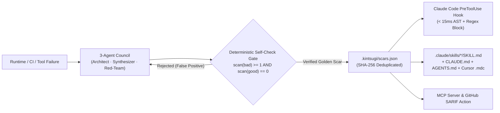

<div align="center">


# Kintsugi Harness (`kintsugi-harness`)

**Turn coding-agent failures into deterministic `PreToolUse` guardrails and portable `SKILL.md` skills.**

[](https://github.com/tunguyen1993/kintsugi-harness/releases)
[](LICENSE)
[](pyproject.toml)
[-success.svg)](pyproject.toml)
[](src/kintsugi/mcp_server.py)

</div>

---

## Why Kintsugi?

**Kintsugi (金継ぎ)** is the Japanese craft of repairing broken pottery with lacquer and gold—treating fractures as structural reinforcement rather than hiding them.

Most "self-learning" agent wrappers simply append free-form prose to `CLAUDE.md` after every mistake. Within a few weeks:
1. **Context bloats** with contradictory instructions that degrade reasoning quality.
2. **Agents still repeat the exact same bug** because Markdown prose is advisory, not executable.
3. **Hallucinated rules** enter the repository without any check for false positives.

**Kintsugi Harness** solves all three problems with a **Zero-Dependency Deterministic Engine** (`< 25ms` cold scan) paired with a **3-Agent Adversarial Evolution Council**:



---

## Key Capabilities

- **Zero External Runtime Dependencies:** Built 100% on the Python 3.9+ standard library (`ast`, `re`, `json`, `urllib`). Cold starts in `< 15ms`—fast enough to run synchronously inside every **Claude Code `PreToolUse` event**.
- **Dual-Engine Deterministic Guard (`AST + Regex`):**
  - **Python AST Visitors:** Detects mutable default arguments, `subprocess(..., shell=True)`, silent `except:` / `except Exception: pass`, `eval`/`exec`/`pickle.loads`/`yaml.load`, synchronous HTTP calls missing `timeout=`, insecure `random.*` on security tokens, plus extensible `call:<fn>` and `missing_kwarg:<fn>:<kwarg>` rules.
  - **Multi-Language Regex Guard:** Covers Python, TypeScript, JavaScript, Go, Rust, Shell, and Markdown (`SKILL.md` prompt-injection & secret DLP).
- **Self-Verifying 3-Agent Evolution Council:** Coordinates **Architect** (e.g., Gemini), **Synthesizer** (e.g., DeepSeek R1), and **Red-Team Critic** (e.g., Muse / OpenAI) over any OpenAI-compatible API. Every candidate rule must pass an in-memory invariant check (`scan(bad_code) >= 1` and `scan(good_code) == 0`) before entering `.kintsugi/scars.json`. Includes an offline zero-API-key fallback.
- **Write-Once, Compile-Everywhere Skills:** Compiles verified Golden Scars into:
  - `.claude/skills/kintsugi-guardrails/SKILL.md` (+ per-category modular skills)
  - Bounded `<!-- KINTSUGI:START -->` governance tables in `CLAUDE.md` and `AGENTS.md` (preserving all human-written sections)
  - `.cursor/rules/kintsugi-guardrails.mdc`
- **Native MCP Server & GitHub Code Scanning (`SARIF 2.1.0`):** Ships with `kintsugi mcp` (`stdio` JSON-RPC 2.0) and a composite `action.yml` for pull-request gating.

---

## Quick Start

### 1. Install

```bash
pip install kintsugi-harness
# Or install from source:
git clone https://github.com/tunguyen1993/kintsugi-harness.git
cd kintsugi-harness
pip install -e .
```

### 2. Initialize Starter Scars & Compile Agent Skills

```bash
kintsugi init
```

This seeds `.kintsugi/scars.json` with Curated Golden Scars (`KS-001`..`KS-012`+) and compiles `.claude/skills/`, `CLAUDE.md`, `AGENTS.md`, and `.cursor/rules/`.

### 3. Wire into Claude Code (`PreToolUse`) & Git `pre-commit`

```bash
kintsugi install-hooks --git
```

Automatically adds `kintsugi hook claude-pre-tool` to `.claude/settings.json` (`Write|Edit|MultiEdit|Bash` matcher). Whenever an agent attempts a dangerous command (e.g. `git reset --hard`) or writes vulnerable code, Kintsugi blocks the tool call in `< 15ms` and returns the verified `✅ Good` replacement directly to the agent.

### 4. Scan Code & Export SARIF 2.1.0

```bash
# Human-readable terminal scan
kintsugi scan . --fail-on HIGH

# Export OASIS SARIF 2.1.0 for GitHub Security tab
kintsugi scan src/ --format sarif --output results.sarif
```

---

## Evolving New Scars from Failures (3-Agent Council)

Configure any OpenAI-compatible endpoints (or run offline with zero keys):

```bash
export GEMINI_API_KEY="..."
export DEEPSEEK_API_KEY="..."
export OPENAI_API_KEY="..."   # or custom KINTSUGI_CRITIC_BASE_URL

kintsugi evolve \
  --summary "Missing UTF-8 encoding in Path.read_text breaks Windows CI" \
  --language python \
  --bad-code 'text = Path("README.md").read_text()' \
  --good-code 'text = Path("README.md").read_text(encoding="utf-8")' \
  --compile-workspace .
```

Verify that every scar in your ledger satisfies true-positive and zero-false-positive invariants:

```bash
kintsugi verify-ledger
```

---

## Model Context Protocol (MCP) Server

Add Kintsugi to **Claude Desktop**, **Claude Code**, **Cursor**, or **Antigravity**:

```json
{
  "mcpServers": {
    "kintsugi": {
      "command": "kintsugi",
      "args": ["mcp", "--ledger", ".kintsugi/scars.json"]
    }
  }
}
```

Exposed MCP tools:
- `kintsugi_scan_code` — Pre-flight scan of generated code or files.
- `kintsugi_list_scars` — Query paired `❌ Anti-Pattern` vs `✅ Verified Fix` examples by language or tag.
- `kintsugi_record_failure` — Evolve and self-verify a new Golden Scar directly from an agent failure trace.
- `kintsugi_compile_skills` — Recompile `SKILL.md`, `CLAUDE.md`, `AGENTS.md`, and `.cursor/rules`.

---

## GitHub Action Usage

```yaml
name: Kintsugi Agent Guard
on: [pull_request]

jobs:
  kintsugi:
    runs-on: ubuntu-latest
    steps:
      - uses: actions/checkout@v4
      - uses: tunguyen1993/kintsugi-harness@main
        with:
          target: "."
          fail-on: "HIGH"
          sarif-output: "kintsugi.sarif"
```

---

## Inline Suppression Pragmas

- Suppress specific scar(s) on a single line:
  ```python
  legacy_cache = {}  # kintsugi: ignore[KS-004]
  ```
- Exclude rule-catalog or Intentional Bad-Fixture files (within the first 5 lines):
  ```python
  # kintsugi: ignore-file
  ```

---

## Contributing & License

Contributions—especially new language AST/Regex Golden Scars that pass `kintsugi verify-ledger`—are warmly welcome! See [CONTRIBUTING.md](CONTRIBUTING.md) for guidelines.

Licensed under the [Apache License 2.0](LICENSE).
