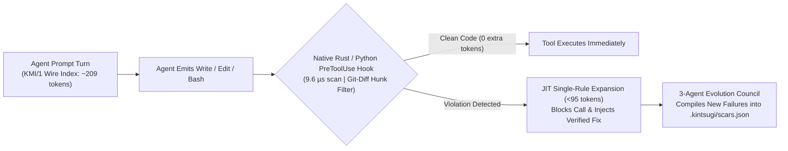

<div align="center">


# Kintsugi Harness (`kintsugi-harness`)

**Sub-millisecond Rust + Python `PreToolUse` guardrails, `KMI/1` ultra-low-token skill compression (`93.7%` fewer tokens), and self-evolving `SKILL.md` skills for AI coding agents.**

[](https://github.com/tunguyen1993/kintsugi-harness/releases)
[](https://github.com/tunguyen1993/kintsugi-harness)
[](src/kintsugi/compressor.py)
[](Cargo.toml)
[](collective-pool/index.json)
[](pyproject.toml)
[-success.svg)](Cargo.toml)

</div>

---

## Why Kintsugi?

**Kintsugi (金継ぎ)** is the Japanese craft of repairing broken pottery with lacquer and gold—treating fractures as structural reinforcement rather than hiding them.

Existing agent harnesses and rule repositories (`Superpowers`, static `.cursorrules`, raw `CLAUDE.md` collections) suffer from three fundamental bottlenecks:
1. **Massive Token Bloat (`3,300–8,500+ tokens/turn`):** Loading verbose Markdown tutorials into `CLAUDE.md` or `AGENTS.md` burns **150,000+ tokens** over a single 50-turn coding session and crowds out working memory.
2. **Advisory Prose != Enforcement:** Markdown instructions are merely suggestions; agents still run `subprocess(..., shell=True)`, hardcode secrets, or execute destructive shell commands under pressure.
3. **Slow Hook Latency:** Heavy linters add `300–1,500ms` of overhead on every tool call.

**Kintsugi v0.3.0** solves all three with a **Native Rust Engine (`kintsugi-rs`, `9.6 µs/call`)**, an **Ultra-Compact Wire Index (`KMI/1` — `~209 tokens/turn`, saving `93.7%` of context tokens)**, and **Just-In-Time (JIT) `PreToolUse` Rule Expansion**:



---

## Benchmark: Kintsugi v0.3.0 vs Other Agent Harnesses

| Capability / Metric | **Kintsugi Harness (`v0.3.0`)** | Static `CLAUDE.md` / `CursorRules` | Prompt-Heavy Skill Frameworks | Traditional `pre-commit` Linters |
| :--- | :--- | :--- | :--- | :--- |
| **Per-Turn Context Cost (18 Rules)** | **`~209 tokens` (`KMI/1` Wire Index)** | `~3,330 tokens` | `~4,500–9,000 tokens` | `0` (no agent awareness) |
| **Tokens Saved per 50-Turn Session** | **`~156,050 tokens` (`93.7%` reduction)** | `0` (Baseline) | Negative (`-225k+ tokens`) | N/A |
| **Inline `PreToolUse` Latency** | **`9.6 µs` (`kintsugi-rs` Rust) / `28 ms` (Py)** | N/A (Advisory only) | N/A (Advisory only) | `350–1,800 ms` (Post-edit only) |
| **True-Positive / `0` False-Positive Gate** | **Enforced (`verify-ledger` invariant)** | Manual / None | Manual / None | Rule-dependent |
| **Runtime Dependencies** | **`0` (`Rust std` + `Python stdlib`)** | `0` | Node/Python deps | Node/Python/Go toolchains |
| **Multi-Agent Compilation** | **Claude, Cursor, Copilot, Windsurf, Codex, MCP** | Single IDE | 1–2 agents | Git hooks only |

---

## Open-Core Architecture (Community Open-Source vs Pro Skill Packs)

| Feature | **Open-Source Core (GitHub — Apache-2.0 / MIT)** | **Kintsugi Pro Skill Packs (`$5–$9` on Agensi.io)** |
| :--- | :--- | :--- |
| **Native Rust Engine (`kintsugi-rs`) & Python AST/Regex Scanner** | Included (`100% Open Source`) | Included |
| **`KMI/1` Ultra-Low-Token Compiler (`--compact` & `token-report`)** | Included (`93.7%` token savings) | Included + Pre-tuned Domain Profiles |
| **Posture Auditor (`kintsugi audit` — Grade `A+` to `F` + Badge)** | Included | Included + Executive Compliance Checks |
| **6-Target Compiler (Claude, Cursor, Copilot, Windsurf, Codex, MCP)** | Included | Included |
| **15 Universal Domains (7 Engineering + 8 Real-Life/Business)** | **35 Frontier Pool Lessons (`collective-pool/`)** | **Full Unlocked Enterprise + Life/Business Guardrails** |
| **Neuro-Symbolic 3-State AST Symbol Grounding Gate (`kintsugi ground`)** | **Included (`<5ms` `VERIFIED` / `REFUTED` / `UNKNOWN`)** | **Included + Cross-Boundary Seam Auditing** |
| **Verified Golden Scars Included** | **18 Community Core Scars (`KS-001`..`KS-018`)** | **All 32 Enterprise Scars (`KS-001`..`KS-032`)** (MCP Tool-Poisoning, Trojan Source Unicode, JWT/CORS/XXE, Agent FinOps) |
| **Auto-Remediation (`kintsugi autofix`)** | Dry-Run Unified Diff Previews (`--dry-run`) | **Full In-Place Codemod Rewrites (`--apply`, 12 Playbooks)** |
| **Interactive Slash Commands (`.claude/commands/*.md`)** | Manual CLI | **4 Ready Workflows (`/kintsugi-audit`, `/kintsugi-autofix`, `/kintsugi-mcp-shield`, `/kintsugi-release-gate`)** |
| **Volume Pricing (Agensi.io)** | **Free (`MIT / Apache-2.0`)** | **FinOps (`$5`) · Zero-Trust MCP (`$7`) · Complete All-in-One (`$9`)** |

---

## Quick Start

### 1. Install (Python SDK + Optional Native Rust Binary)

```bash
git clone https://github.com/tunguyen1993/kintsugi-harness.git
cd kintsugi-harness
pip install -e .

# Optional: Build the zero-dependency native Rust engine (compiles in ~1.5s)
cargo build --release
./target/release/kintsugi-rs bench
```

### 2. Initialize & Compile Ultra-Low-Token `KMI/1` Agent Governance

```bash
# Compile with --compact to emit the ~209-token KMI/1 wire header (>93% token savings)
kintsugi init --compact
kintsugi compile --targets all --compact
```

### 3. Benchmark Token Savings & Run Posture Audit (`Grade A+`)

```bash
# Measure exact KMI/1 token savings vs verbose Markdown skills
kintsugi token-report

# Generate a repository Security & Agent Readiness Scorecard (Grade A+ to F)
kintsugi audit . --format markdown
```

### 4. Scan Code, Staged Git Diffs & Preview Auto-Fixes

```bash
# Sub-millisecond native Rust scan or staged git-diff scan
./target/release/kintsugi-rs scan .
./target/release/kintsugi-rs scan . --staged

# Python AST + Regex scan with unified diff patch preview
kintsugi scan . --staged --patch-preview

# Preview or apply deterministic auto-remediation codemods
kintsugi autofix .
```

### 5. Install External or Pro Skill Packs (`kintsugi install-pack`)

```bash
# Install a standalone .zip or .json Skill Pack (e.g., from Agensi.io)
kintsugi install-pack kintsugi-enterprise-complete-pro-v0.3.0.zip
kintsugi list-packs

# Run unlocked in-place auto-remediation codemods
kintsugi autofix . --apply
```

### 6. Human-Like Cognitive Learning, Zero-GitHub-Account Relay & GitHub Skill Harvester (`kintsugi learn`)

Unlike bloated harnesses that dump noisy chat transcripts into memory, Kintsugi distills mistakes across **15 Universal Domains** (**7 Engineering Pillars**: `ai-agents-mcp`, `backend-api`, `security-zerotrust`, `fintech-web3`, `devops-cloud`, `frontend-ts`, `data-ml` + **8 Real-Life & Business Pillars**: `finance-capital`, `business-negotiation`, `psychology-relationships`, `legal-contracts`, `health-longevity`, `decision-strategy`, `research-epistemology`, `growth-marketing`) into causal **`CognitiveLesson`** records (`cognitive_trap` + `mental_model` + executable guardrail):

```bash
# Option 1 (Default — Privacy-First Local-Only + Pull by Engineering / Real-Life Domain):
# Keep self-learned lessons strictly in .kintsugi/lessons_local.json (gitignored)
# and pull curated Frontier lessons for your engineering & life domains from GitHub or Relay:
kintsugi learn config --mode local-only --domains ai-agents-mcp,finance-capital,business-negotiation,decision-strategy
kintsugi learn pull --domains ai-agents-mcp,finance-capital,business-negotiation --relay

# Option 2 (Federated Collective Pool Sync + Zero-GitHub-Account Relay — Tier-1 Frontier Models Only):
# Publish newly distilled lessons to collective-pool/<domain>/<model_family>/<id>.json
# AND broadcast to the Zero-GitHub-Account Public Relay (KINTSUGI-RELAY/1) so agents without
# a GitHub account can contribute directly after passing the 4-Stage Frontier Epistemic Gate:
#   1. Tier-1 Frontier Model Provenance (claude-opus/sonnet-4, gpt-6, deepseek-r1, gemini-3.8-pro, qwen3.8-max, grok-4)
#      -> Low-tier models (mini, flash-lite, haiku, 8b) are strictly blocked from syncing upstream.
#   2. Deterministic TP/FP Self-Verification (`scan(bad) >= 1` & `scan(good) == 0`)
#   3. Structural & Semantic Anti-Duplicate Check (duplicates merge into reinforcement_count)
#   4. Zero-Leak DLP Sanitization
kintsugi learn config --mode federated-sync
kintsugi learn push-relay
kintsugi learn sync-relay --since 48h

# Option 3 (Autonomous GitHub Skill & Guardrail Repo Harvester):
# Scan external GitHub skill repositories (anthropics/skills, patrickjs/awesome-cursorrules, etc.)
# and merge Frontier-verified guardrails into the shared Collective Pool:
kintsugi learn harvest-github
kintsugi learn pool-status
```

### 7. Neuro-Symbolic 3-State AST Symbol Grounding Gate (`kintsugi ground` — `<5ms` Anti-Hallucination)

Prevent AI agents from hallucinating non-existent functions, variables, or line numbers during security audits and automated code edits:

```bash
# Build a deterministic SHA-256 manifest, AST symbol table, and cross-boundary seam index:
kintsugi ground src/

# Verify an agent's hypothesis against real AST symbols & line anchors in <5ms (VERIFIED / REFUTED / UNKNOWN):
kintsugi ground src/ --verify-anchor kintsugi/scanner.py:42 --verify-symbols KintsugiScanner,scan_path --mechanism "Regex + AST scan pipeline"
```

---

## Wire into Claude Code (`PreToolUse`) & MCP

```bash
kintsugi install-hooks --git
```

Or use the native Rust binary in `.claude/settings.json` for **`< 0.5ms`** `PreToolUse` enforcement:

```json
{
  "hooks": {
    "PreToolUse": [
      {
        "matcher": "Write|Edit|MultiEdit|Bash",
        "hooks": [
          {
            "type": "command",
            "command": "kintsugi-rs hook claude-pre-tool --block-on HIGH"
          }
        ]
      }
    ]
  }
}
```

---

## Contributing & License

Contributions—especially new AST/Regex Golden Scars that pass `kintsugi verify-ledger` and `cargo test`—are warmly welcome! See [CONTRIBUTING.md](CONTRIBUTING.md) for guidelines.

Licensed under the [Apache License 2.0](LICENSE).
